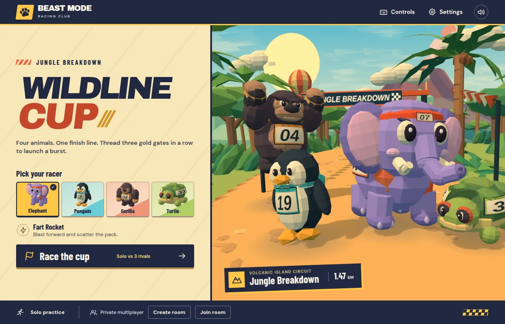

# Beast Mode · Natural Disasters

*Evolution was a mistake. Now it’s a race.*

A desktop-browser party racer for **2–8 players**. Race friends down Jungle Breakdown, a 1.47 km obstacle course with six checkpoints. Grab someone before a bridge, belly-slide down Cannonball Hill, or take your chances with an elephant’s rocket boost. Solo practice runs the same course and physics.



## Play locally

Install **Node.js 22.12 or newer** and run the following from the repository root.

```sh
npm ci
npm run dev
```

Open **http://localhost:5173** in a desktop browser with WebGL 2 enabled. Choose **Create room**, enter a nickname, then share the five-character room code. Other players choose **Join room**. Pick animals, try their movement in the lobby, and ready up. The host starts the race when every guest is ready.

To play on the same Wi-Fi, friends open the host computer’s LAN IP on port 5173. Each browser must reach the same server. The Vite development server proxies Socket.IO to port 3001. Multiple tabs can also join a single room.

## Controls

| Input | Action |
| --- | --- |
| W A S D or arrow keys | Move relative to the camera |
| Drag on the 3D scene | Orbit the camera |
| Shift | Sprint |
| Space | Jump, or escape a gorilla’s grip after a short delay |
| E | Activate a special or throw a held racer |
| F | Grab a nearby opponent as the gorilla |
| Q | Resist a triggered instinct |
| Esc | Open the race menu |

Settings let you adjust the music, effects, announcer and camera distance. The race continues while a player has a menu open. In solo practice, use **Esc → Change racer** to return to the grid.

| Racer | Special | Cooldown |
| --- | --- | --- |
| Elephant | Fart Rocket propels you forward and pushes nearby animals. A collision can cut your boost short. | 12 s |
| Penguin | Belly Slide trades steering for speed. Aim for the downhill and avoid the mud. | 8 s |
| Gorilla | Grab a nearby racer with F, then use E to throw them in the direction the camera faces. | 10 s |
| Turtle | Shell Roll accelerates downhill and can bounce off obstacles. | 9 s |

## Race rules

Cross the gates in order. Falling returns you to the last checkpoint. The server warns the field before one eight-second Low Gravity or Banana Rain event. A race ends when everyone finishes, after four minutes, or when a multiplayer field drops below two racers. Finished racers place first by crossing time. Unfinished racers are ranked by their last checkpoint and progress along the course. The host can start a rematch with the same animals or return everyone to the lobby.

Rooms are in memory. A disconnect removes that racer and transfers hosting to the next player when needed. Rejoin with the code while the room is waiting. An empty room closes.

## Build and verify

```sh
npm run typecheck
npm test
npm run build
npm start
```

After the build, **http://localhost:3001** serves both the game and Socket.IO. Set `PORT` to change the server port or `HOST` to change its listen address. The browser and server must share an origin, including the `/socket.io` endpoint.

With the game running and Google Chrome installed, run `npm run test:browser` in a second terminal for a four-tab smoke test. Set `CHROME_PATH` for a different Chromium binary, `GAME_URL` for a different game origin, and `SCREENSHOT_DIR` to save the rendered screens.

## Project layout

- **client/** — Vite and vanilla TypeScript. Three.js draws the animals, track and effects. Web Audio synthesizes the music and sounds.
- **server/** — Node.js, Socket.IO and Rapier 3D. The server simulates movement at 30 Hz and broadcasts snapshots at 15 Hz. It owns collisions, special cooldowns, event timing, checkpoints and finish order.
- **shared/** — Typed network protocol, animal configuration, course geometry and moving hazard trajectories.
- **server/test/** — Physics regression tests and real Socket.IO clients driving accelerated races through the normal input protocol.
- **scripts/browser-smoke.mjs** — Browser interaction checks for settings, joining, ready states, driving, race UI and disconnect handling.

Animal models, track props, animations and synthesis are procedural. The bundled font licenses are in `client/public/fonts/`.
